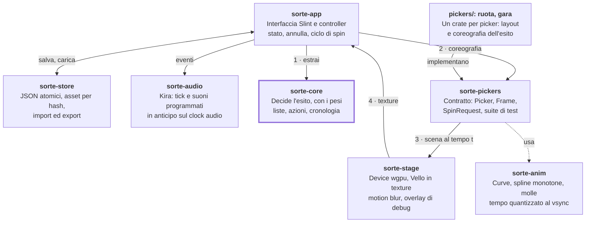

# Sorte — Documento di design

Nov 5, 2026 · @Edoardo

> Copia del [documento vivo su Claude Docs](https://claude.ai/artifact/RGPkDkXjcLUaJxcUy6mzQQ), esportata il 5 novembre 2026 dopo la revisione. I due diagrammi (architettura e roadmap) sono trascritti in testo.

## Sommario

Sorte è un'app desktop nativa per Windows, macOS e Linux che estrae a sorte un elemento da una lista. Parte da una ruota in stile PickerWheel e cresce con altri picker, come una gara di cavalli, tutti animati con cura frame per frame.

Tre decisioni reggono il design:

- **Rust, interfaccia in Slint, scena animata disegnata da Vello su wgpu.** Slint dà un'interfaccia desktop rifinita; la scena, renderizzata in una texture, dà il controllo completo su ogni frame.
- **Prima si decide l'esito, poi lo si mette in scena.** L'estrazione usa il generatore casuale del sistema operativo e non dipende da durata, velocità o tipo di picker.
- **I picker sono moduli.** Ogni picker implementa un solo contratto e riceve già pronti voci, pesi, modalità, cronologia, audio e salvataggio.

Tutto funziona offline, senza account né server, e il codice è open source sotto GPLv3. "Sorte" è un nome provvisorio.

## Obiettivi e non-obiettivi

La prima versione punta a una ruota alla pari di PickerWheel, ma più fluida e interamente offline.

**Obiettivi**

- Animazioni senza scatti alla frequenza del monitor (da 60 a 240 Hz), con testo nitido anche in movimento.
- Estrazione equa e verificata da test statistici, pesi compresi.
- Parità con le funzioni di PickerWheel che non richiedono un server (sezione successiva).
- Un contratto per i picker abbastanza generale da ospitare la gara di cavalli senza toccare il core.
- Avvio rapido, un solo eseguibile, nessun runtime esterno da installare.

**Non-obiettivi della prima versione**

- Account, cloud, link di condivisione e raccolta risultati: richiedono un backend.
- Generazione di idee con AI.
- Versioni mobile e web: l'architettura non le esclude, ma non guidano le scelte.
- Monetizzazione.

## Riferimento: PickerWheel

Quasi tutto ciò che [PickerWheel](https://pickerwheel.com/) offre senza server entra tra MVP e v1; restano fuori solo le funzioni che richiedono un backend. Non riusiamo nome, logo, testi o grafica: il concetto di ruota è generico, l'implementazione è nostra.

| Funzionalità di PickerWheel | In Sorte |
| --- | --- |
| Voci di testo, aggiunte una alla volta o incollando più righe | MVP |
| Duplica, nascondi, elimina, modifica di una voce | MVP |
| Azioni sul risultato: Fatto, Nascondi scelta, Nascondi tutte le istanze, Aggiungi conteggio | MVP |
| Spin con pulsante o Ctrl+Invio | MVP |
| Velocità da 1 a 10 e durata da 1 a 30 s | MVP |
| Cronologia dei risultati | MVP |
| Più ruote con passaggio rapido (PickerWheel: fino a 5, salva solo l'attiva) | MVP, senza limite e tutte salvate |
| Suoni di partenza, rotazione e fine | MVP predefiniti, v1 personalizzabili |
| Voci immagine, anche miste a testo | v1 |
| Peso per voce, con spicchio proporzionale al peso | v1 |
| Etichetta che sostituisce il testo sulla ruota | v1 |
| Colore per voce | v1 |
| Selezione multipla e modifica in blocco | v1 |
| Mescola, ordina A–Z, ordine manuale, cerca, elimina voci vuote | v1 |
| Import CSV e modalità testo (`2,Voce` per il peso, `~Voce~` per nasconderla) | v1 |
| Stop manuale, angolo iniziale casuale, rotazione d'attesa | v1 |
| Punteggi accumulati in ordine decrescente | v1 |
| Titolo, descrizione e titoli del risultato che si alternano | v1 |
| Ruota misteriosa (voci come "?") e risultato nascosto fino al clic | v1 |
| Confetti, temi colore, colore e sfondo della pagina | v1 |
| Schermo intero | v1 |
| Lettura ad alta voce del risultato | Dopo la v1 |
| Logo, banner, pulsante di spin personalizzato | Dopo la v1 |
| Link di condivisione, raccolta risultati, idee generate con AI | No: richiedono un backend |

## Requisiti funzionali

Il modello centrale è "una lista, più modi di estrarre": le voci appartengono alla lista, il picker è solo il modo di metterle in scena. Oltre alla parità con PickerWheel, Sorte aggiunge i requisiti seguenti; le milestone sono definite nella Roadmap.

| ID | Requisito | Milestone |
| --- | --- | --- |
| F1 | Ogni lista si può estrarre con qualsiasi picker installato; il picker si sceglie per lista e si cambia in un clic; i picker che non accettano il numero di voci della lista restano nell'elenco, disattivati, con il motivo | MVP |
| F2 | Editor voci con modifica in linea, riordino trascinando e incolla multiriga | MVP |
| F3 | Annulla e ripeti per ogni modifica a voci e impostazioni | MVP |
| F4 | Estrazione con pulsante, Spazio o Ctrl+Invio; la ruota si può anche lanciare trascinandola con il mouse | MVP |
| F5 | Sovrapposizione risultato con le quattro azioni di PickerWheel, usabile solo da tastiera (Tab, Invio, Esc; Esc vale come Fatto) | MVP |
| F6 | Autosalvataggio di tutte le liste e cronologia per lista | MVP |
| F7 | Stop manuale che anticipa l'arresto senza cambiare l'esito già deciso | v1 |
| F8 | Modalità presentazione: schermo intero, pannelli nascosti, sfondo a tinta unita per il chroma key di chi fa streaming | v1 |
| F9 | Import ed export: CSV, testo nel formato di PickerWheel, file `.sorte` con immagini incluse, immagine PNG della ruota | v1 |
| F10 | Interfaccia in italiano e inglese | v1 |
| F11 | Gara di cavalli da 2 a 12 corsie con regola "vince chi arriva primo" o "vince chi arriva ultimo" | M3 |
| F12 | Modalità verificabile: il seme viene dal generatore del sistema operativo e l'estrazione da ChaCha20 con quel seme; prima dello spin si mostra l'impronta del seme, dopo si rivela il seme per ricalcolare l'esito | Dopo M4 |

## Requisiti non funzionali

La fluidità è il requisito che decide l'architettura: ogni scelta successiva serve a non perdere frame e a non far mai scattare il testo. Le soglie sono obiettivi da confermare nello spike (M0).

| Area | Obiettivo | Come si verifica |
| --- | --- | --- |
| Fluidità | Zero frame persi in uno spin di 10 s a 144 Hz sulla macchina di riferimento | Contatore di frame persi nell'overlay di debug |
| Qualità visiva | Bordi antialiasati, testo nitido a riposo, motion blur oltre una soglia di velocità | Immagini di riferimento e revisione visiva |
| Sincronia audio | Tick entro 10 ms dal passaggio dello spicchio sotto la lancetta | Registrazione audio e video del test |
| Scala | Fino a 1.000 voci senza cali di frame; etichette nascoste quando lo spicchio è troppo stretto | Benchmark nello spike |
| Consumi | CPU e GPU quasi a zero quando nulla si muove | Monitor di sistema a riposo |
| Avvio | Finestra pronta in meno di 1 s a freddo | Misura su tre sistemi |
| Equità | Frequenza di ogni voce pari a peso ÷ somma dei pesi, entro la tolleranza del test chi-quadro su 10⁶ estrazioni | Test automatici |
| Privacy | Nessuna connessione di rete, nessuna telemetria | Revisione delle dipendenze |
| Accessibilità | Tutto usabile da tastiera, etichette per i lettori di schermo, opzione "Riduci animazioni" | Checklist manuale |
| Robustezza | Nessuna perdita di dati in caso di crash o spegnimento | Test di interruzione durante il salvataggio |

## Esperienza utente

La finestra principale divide lo spazio tra la scena, a sinistra, e un pannello laterale a destra; tutto il resto sono sovrapposizioni o finestre secondarie. Lo stile parte dal tema Fluent di Slint e passa via via a componenti propri, con colori, raggi e curve di movimento definiti come design token.

**Schermate**

| Schermata | Contenuto |
| --- | --- |
| Finestra principale | Barra in alto con lista attiva, scelta del picker, Nuova, Importa, Esporta, Presentazione e un menu con Preferenze e Informazioni (su macOS il menu dell'app); scena con il picker; pannello con le schede Voci, Risultati, Aspetto |
| Risultato | Sovrapposizione animata sulla scena: titolo del risultato, voce estratta (testo o immagine) o classifica per i picker a classifica, le quattro azioni |
| Liste | Elenco ricercabile delle liste salvate, con duplica, elimina e ordine per uso recente |
| Aspetto e animazione | Impostazioni della lista e del picker: colori, suoni, velocità, durata, confetti, ruota misteriosa |
| Preferenze | Tema chiaro o scuro, lingua, volume generale, Riduci animazioni, cartella dei dati |
| Presentazione | Solo la scena a schermo intero, con sfondo a tinta unita opzionale |
| Informazioni | Versione, licenza GPLv3, licenze di terze parti e il widget AboutSlint, non obbligatorio con la GPLv3 |

**Flusso principale**

1. All'avvio si riapre l'ultima lista usata.
2. L'utente scrive o incolla le voci; la scena si aggiorna mentre digita.
3. Spazio avvia l'estrazione: il core decide l'esito, il picker lo anima.
4. All'arrivo partono suono e confetti, poi compare la sovrapposizione risultato.
5. L'azione scelta aggiorna lista e cronologia; Spazio riparte dal punto 3.

**Scorciatoie** (su macOS Cmd al posto di Ctrl)

| Tasto | Azione |
| --- | --- |
| Spazio o Ctrl+Invio | Estrai (Spazio solo quando il cursore non è in un campo di testo) |
| Invio, Esc | Conferma l'azione evidenziata, chiudi il risultato (Esc vale come Fatto) |
| Ctrl+Z, Ctrl+Shift+Z | Annulla, ripeti |
| Ctrl+N | Nuova lista |
| Ctrl+F | Cerca tra le voci |
| Ctrl+1 … Ctrl+9 | Passa al picker in quella posizione del registro (1 la ruota, 2 la gara) |
| F11 | Presentazione |

## Stack tecnologico e decisione

Decisione: interfaccia in Slint, scena animata disegnata da Vello in una texture wgpu che Slint mostra come immagine, audio con Kira. Slint fa ciò che sa fare meglio (finestre, liste, form, tastiera); la scena resta interamente nostra, frame per frame.

| Ambito | Scelta | Perché |
| --- | --- | --- |
| Linguaggio | Rust stable, edizione 2024, almeno Rust 1.92 (lo richiede Slint 1.18.1) | Prestazioni prevedibili, nessuna pausa del garbage collector durante le animazioni |
| Interfaccia | [Slint](https://docs.slint.dev/latest/docs/rust/slint/wgpu_30/) 1.18 | UI desktop dichiarativa con anteprima dal vivo; dalla [1.17](https://github.com/slint-ui/slint/discussions/12124) drag and drop, icona di sistema, tooltip e ombre più ricche |
| Scena animata | [Vello](https://docs.rs/crate/vello/latest) 0.11 su wgpu 30 | Grafica vettoriale ridisegnata sulla GPU a ogni frame: bordi e testo nitidi a qualunque angolo |
| Ponte UI e scena | Feature `unstable-wgpu-30` di Slint | Slint e Vello condividono device e coda wgpu; la texture della scena entra nella UI con `Image::try_from` |
| Testo nella scena | Parley, font incorporati nell'app | Misura, adattamento e troncamento delle etichette; i glifi li disegna Vello |
| Audio | [Kira](https://docs.rs/crate/kira/latest/source/src/lib.rs) 0.12 | Clock per programmare i suoni in anticipo, mixer ed effetti |
| Casualità | `rand` 0.10: generatore del sistema operativo (SysRng) e Uniform per l'estrazione | Estrazione crittograficamente sicura e senza bias |
| Salvataggio | serde e JSON, scritture atomiche | File leggibili, esportabili e facili da migrare |

**Vincoli che la scelta porta con sé**

- **Versioni di wgpu allineate.** Slint 1.18 espone wgpu 29 e 30 dietro feature dichiarate instabili, che possono cambiare nelle minor; Vello 0.11 richiede wgpu 30. Slint, Vello e wgpu si fissano in \[workspace.dependencies\], Slint con \~1.18, e si aggiornano insieme; il codice wgpu sta tutto in `sorte-stage`.
- **Ponte Slint↔wgpu.** `sorte-stage` crea device e coda wgpu con i limiti che servono a Vello: quelli di default di Slint (`Limits::downlevel_webgl2_defaults()`) hanno compute e storage a zero. `sorte-app` li passa a Slint con `WGPUConfiguration::Manual` e converte la texture della scena con `Image::try_from`, quindi tocca i tipi wgpu solo per passarli. La texture è `Rgba8Unorm` con `STORAGE_BINDING`, `TEXTURE_BINDING` e `RENDER_ATTACHMENT`. La feature `renderer-vello` di Slint non si attiva: porta Vello 0.10 su wgpu 29.
- **Vello è dichiarato in fase alpha e richiede GPU con compute shader.** Blur e filtri non ci sono ancora: il motion blur sarà un nostro passaggio wgpu. Per le GPU senza compute serve un renderer di riserva su CPU (vello\_cpu). Ha un'API sua e non disegna una vello::Scene, quindi Frame è un'astrazione di disegno nostra, con un backend Vello GPU e uno vello\_cpu in sorte-stage; RendererOptions::use\_cpu di Vello non basta, perché richiede comunque un device wgpu. Con vello\_cpu il motion blur si salta.
- **Licenza di Slint.** La [Royalty-free 2.0](https://raw.githubusercontent.com/slint-ui/slint/master/LICENSES/LicenseRef-Slint-Royalty-free-2.0.md) permette app desktop proprietarie gratis, a patto di mostrare il widget AboutSlint in una finestra Informazioni raggiungibile dal menu principale, oppure il badge di Slint sulla pagina di download. In alternativa c'è la GPLv3: Sorte la adotta ed è open source, quindi il widget AboutSlint resta come cortesia ma non è obbligatorio.

**Alternative valutate**

| Alternativa | Perché non ora |
| --- | --- |
| Bevy 0.19 + egui | Ottimo per picker in stile videogioco, ma l'editor di liste in egui è meno rifinito e le API di Bevy cambiano a ogni release. Resta il piano B per picker 3D o con fisica: Slint offre un esempio di integrazione con Bevy e un modulo wgpu 29 pensato per Bevy 0.19 |
| Solo egui | Veloce da scrivere, ma l'aspetto è da strumento e le animazioni vanno costruite comunque a mano |
| Solo Slint, scena fatta di elementi Slint | Nessun ponte wgpu da mantenere, ma meno controllo su frame, testo ruotato ed effetti. È il ripiego se il ponte wgpu si rivela instabile |
| Flutter, React Native, Compose | Scartati per la scelta di Rust |
| Electron, Tauri | Interfaccia in webview |

## Architettura

Il workspace ha sette crate di base più un crate per ogni picker in pickers/ (ruota e gara): solo `sorte-app` conosce Slint e solo `sorte-stage` disegna con wgpu (sorte-app tocca i tipi wgpu solo per passare device e texture a Slint), così core e picker si testano senza GPU né interfaccia.

**Il core decide chi vince, picker e scena lo mettono in scena.** Crate del workspace; i numeri seguono un'estrazione.



Un'estrazione segue i numeri: il controller chiede l'esito al core, il picker lo trasforma in coreografia, la scena la disegna e Slint mostra la texture. Audio e salvataggio restano ai lati del flusso.

**Ciclo di frame**

1. Slint invoca il notificatore di rendering prima di disegnare la finestra.
2. Il clock calcola t, quantizzato al vsync. Da dove leggere i vsync va trovato nello spike: il notificatore di Slint non passa timestamp né frequenza del monitor.
3. La coreografia attiva disegna lo stato al tempo t, attraverso Frame, in una scena Vello.
4. Vello la rende nella texture, sullo stesso device wgpu di Slint, che la compone con il resto dell'interfaccia.
5. Finché c'è un'animazione attiva, una coreografia o la rotazione d'attesa, si richiede il frame successivo; altrimenti l'app torna inattiva.

**Thread**

- Thread dell'interfaccia: eventi, controller, rendering di scena e UI, così wgpu resta su un solo thread.
- Thread audio di Kira: mixaggio e suoni programmati.
- Thread di I/O: salvataggi, import ed export (il PNG lo disegna sorte-stage sul thread dell'interfaccia, il file lo scrive sorte-store qui), con i risultati riportati all'interfaccia tramite `slint::invoke_from_event_loop`.

**Dipendenze e tipi**

- `sorte-core` e `sorte-anim` non dipendono da altri crate del workspace.
- `sorte-pickers` contiene il contratto (`Picker`, `Choreography`, `Frame`, `SpinRequest`) e la suite di contratto, e usa core e anim; i crate in `pickers/` usano `sorte-pickers`, core e anim.
- `sorte-stage` usa `sorte-pickers` per `Frame`, `sorte-store` usa core, `sorte-audio` usa `sorte-pickers` per gli eventi, `sorte-app` usa tutti.
- `ListDoc`, `Entry`, `DrawRecord` e `Outcome` stanno in `sorte-core`; `sorte-store` gestisce file, scritture atomiche, migrazioni e asset.

## Modello a plugin dei picker

Un picker riceve un esito già deciso e restituisce una coreografia: una funzione pura del tempo che lo mette in scena. Non sceglie mai il vincitore, quindi aggiungere un picker non può rendere l'app meno equa.

```rust
/// Cosa sa fare un picker e come si presenta nell'interfaccia.
pub struct PickerMeta {
    pub id: &'static str,                 // "wheel", "horse-race"
    pub name: LocalizedStr,
    pub outcome: OutcomeKind,             // Single | Ranking
    pub entries: RangeInclusive<usize>,   // es. 2..=12 per la gara
    pub supports_images: bool,
}

/// Frame è l'astrazione di disegno di Sorte: sorte-stage la implementa con Vello e con vello_cpu.
pub trait Picker {
    fn meta(&self) -> &PickerMeta;
    /// Schema delle impostazioni: il pannello Aspetto si genera da qui.
    fn settings_schema(&self) -> SettingsSchema;
    /// Ricalcola la scena statica quando cambiano voci, pesi o impostazioni.
    fn prepare(&mut self, list: &ListView, settings: &PickerSettings, assets: &Assets) -> Result<()>;
    /// Disegna lo stato di riposo, anche animato (es. rotazione d'attesa).
    /// `rest`: stato lasciato dall'ultimo spin (per la ruota, l'angolo), che il controller conserva.
    fn render_idle(&self, frame: &mut Frame, rest: f32, t: Seconds);
    /// Trasforma un gesto (es. trascinare la ruota) in un lancio: restituisce la velocità
    /// angolare al rilascio, e il controller ne fa uno SpinRequest.
    fn on_pointer(&mut self, ev: &PointerEvent) -> Option<f32> { None }
    /// Costruisce la coreografia che termina sull'esito.
    fn choreograph(&self, outcome: &Outcome, req: &SpinRequest, rng: &mut CosmeticRng)
        -> Box<dyn Choreography>;
}

pub trait Choreography {
    fn duration(&self) -> Seconds;
    /// Stato visivo calcolato solo da t: nessun accumulo di delta tra un frame e l'altro.
    fn render(&self, frame: &mut Frame, t: Seconds);
    /// Eventi noti in anticipo (tick, partenza, arrivo) per audio ed effetti.
    fn events(&self) -> &[TimedEvent];
    /// Stato di riposo all'arrivo (per la ruota, l'angolo): il controller lo conserva.
    fn rest(&self) -> f32;
    /// Stop manuale: nuova coreografia che parte dallo stato in `at` e arriva allo stesso esito.
    fn replan_stop(&self, at: Seconds) -> Option<Box<dyn Choreography>> { None }
}

/// La compila il controller da impostazioni della lista, Preferenze ed eventuale lancio.
pub struct SpinRequest {
    pub speed_level: u8,      // 1..=10
    pub duration: Seconds,    // 1..=30 s
    pub reduce_motion: bool,  // Preferenze: Riduci animazioni
    pub start: f32,           // stato di riposo di partenza (per la ruota, θ₀)
    pub fling: Option<f32>,   // velocità angolare al rilascio, già limitata
}

pub struct Outcome {
    pub selected: EntryId,               // scelta in proporzione al peso
    pub ranking: Option<Vec<EntryId>>,   // solo per i picker a classifica
}
```

**Ciclo di vita di un'estrazione**

1. Il controller congela la lista: durante lo spin le voci non si modificano.
2. Il core sceglie la voce con il generatore del sistema operativo e, se il picker lo chiede, costruisce la classifica secondo la regola (primo o ultimo), che il controller gli passa con la richiesta di estrazione.
3. Il picker riceve l'esito e un generatore cosmetico con seme proprio, più lo SpinRequest (velocità, durata, Riduci animazioni, stato di partenza, eventuale lancio), e restituisce la coreografia.
4. Il ciclo di frame chiama `render(t)` finché `t` raggiunge la durata; il modulo audio programma gli eventi e, con uno stop manuale, annulla quelli già programmati dopo lo stop.
5. Il controller conserva lo stato di riposo, mostra il risultato, applica l'azione scelta e salva.

**Aggiungere un picker**

1. Crea un crate in `pickers/` e implementa `Picker`.
2. Dichiara i metadati: tipo di esito, numero di voci ammesse, supporto delle immagini.
3. Descrivi le impostazioni con lo schema; il pannello si genera da solo.
4. Registralo nel registro dei picker di sorte-app (è l'unica modifica ammessa fuori dal suo crate), senza modifiche a core, salvataggio o UI.
5. Supera i test di contratto, la suite di sorte-pickers che ogni crate di picker richiama nei propri test: per esiti casuali la coreografia termina sempre sull'esito ed entro la durata dichiarata.

Nella v1 i picker sono compilati dentro l'app. Picker caricati a runtime, come componenti WebAssembly in sandbox, restano un'opzione per dopo, se serviranno picker scritti da altri.

## Algoritmi chiave

L'equità sta tutta nell'estrazione; ruota e gara sono matematica deterministica che porta sull'esito già scelto.

### Estrazione equa

- I pesi sono interi da 1 a 1.000; senza pesi valgono tutti 1. Gli interi rendono l'aritmetica esatta.
- Si estrae un intero uniforme r in \[0, W), con W somma dei pesi delle voci visibili, e si sceglie la prima voce la cui somma cumulativa supera r (ricerca binaria). `Uniform::new(0, W)` di rand evita il bias da modulo e anche quello minimo di random\_range, il nome che gen\_range ha preso in rand 0.9.
- Nei picker a classifica la voce scelta va in testa (regola "primo") o in coda (regola "ultimo"); le altre si mescolano con Fisher–Yates. La probabilità di essere selezionati resta quindi la stessa per ogni regola.
- "Nascondi tutte le istanze" disattiva le voci con lo stesso testo normalizzato (minuscole, spazi compressi).
- La casualità visiva (punto d'arrivo nello spicchio, andamento dei cavalli) usa un generatore separato: non può influire sull'esito.

```latex
P(i) = \frac{w_i}{W}, \qquad W = \sum_{j \in \text{visibili}} w_j
```

### Spin della ruota

Angoli in senso orario sullo schermo, lancetta all'angolo p. Lo spicchio i inizia a s\_i e ha ampiezza a\_i = 2π · w\_i / W.

1. Si sceglie il punto d'arrivo nello spicchio estratto k, lontano dai bordi: φ = s\_k + u · a\_k, con u uniforme tra 0,15 e 0,85.
2. Partendo dall'angolo θ₀ e aggiungendo K giri completi, la rotazione totale è:

```latex
\Delta = \big((p - \varphi - \theta_0) \bmod 2\pi\big) + 2\pi K
```

3. L'angolo nel tempo, per τ da 0 a T, decelera fino a fermarsi:

```latex
\theta(\tau) = \theta_0 + \Delta \, E\!\left(\frac{\tau}{T}\right), \qquad E(x) = 1 - (1 - x)^n
```

4. La velocità iniziale vale ω₀ = n · Δ / T. La durata (1–30 s) fissa T e il livello di velocità (1–10) sceglie ω₀ da una tabella; da qui si ricavano K e n, con n tra 2,5 e 6. Se nessun K intero dà n in quell'intervallo (succede quando ω₀ · T è sotto circa 27 rad), si ritocca ω₀ verso il valore fattibile più vicino.
5. I tick si calcolano in forma chiusa: se la lancetta incontra un bordo dopo una rotazione b ≤ Δ, il tick cade a

```latex
\tau_b = T\left(1 - \left(1 - \frac{b}{\Delta}\right)^{1/n}\right)
```

6. Stop manuale: dallo stato corrente (θ\_c, ω\_c) si pianifica un nuovo tratto verso lo stesso φ, con il minimo numero di giri e la stessa velocità al raccordo (n′ · Δ′ / T′ = ω\_c).
7. Lancio col mouse: la velocità angolare al rilascio, limitata a un intervallo, diventa ω₀ e la durata segue da T = n · Δ / ω₀, limitata a 1–30 s.

Caricamento e accelerazione, quando ci sono, sono tratti brevi in testa compresi in T: la decelerazione E(x) parte alla loro fine, e i tick di ogni tratto si calcolano in forma chiusa. Tra uno spin e l'altro lo stato di riposo, cioè l'angolo, lo tiene il controller: la coreografia lo restituisce all'arrivo con `rest()` e lo SpinRequest successivo lo riporta come θ₀. Con Riduci animazioni la ruota non gira (sezione Qualità delle animazioni).

### Gara di cavalli

1. La classifica arriva dal core. Il primo arriva a T, gli altri con distacchi casuali crescenti, alcuni minimi per avere fotofinish.
2. Per ogni cavallo la progressione p\_i(t) è un'interpolazione cubica monotona (Fritsch–Carlson) tra 6 e 10 nodi con velocità casuali positive, normalizzata per valere esattamente L al proprio arrivo. La monotonia garantisce che nessuno torni indietro.
3. Lo spettacolo si ottiene scartando e rigenerando con il generatore cosmetico: almeno due cambi di testa, vincitore mai in testa dall'inizio alla fine, rapporto tra velocità massima e minima entro 1,6.
4. La cadenza del galoppo segue la velocità sul terreno, così le zampe non pattinano. La telecamera segue la testa della corsa con una molla smorzata e si ferma sul fotofinish quando il distacco è sotto 0,1 s.
5. Con la regola "vince l'ultimo" lo schema è identico, con la voce scelta in coda; la telecamera chiude sul gruppo di coda.

### Etichette e colori della ruota

- Testo radiale allineato al bordo. La dimensione è la minore tra il massimo del tema e quella che entra nella larghezza dello spicchio nel punto più vicino al centro.
- Sotto i 9 px il testo non si disegna; la voce resta leggibile nell'elenco e nel tooltip al passaggio del mouse.
- Il troncamento con i puntini di sospensione usa le misure di Parley.
- I colori ciclano sulla tavolozza evitando che primo e ultimo spicchio coincidano; il colore del testo garantisce un contrasto WCAG di almeno 4,5:1.

## Qualità delle animazioni

Qui "perfetta" significa tre cose misurabili: nessun frame perso, nessun salto di tempo tra un frame e l'altro, suono e immagine che coincidono.

| Tecnica | Cosa risolve | Come |
| --- | --- | --- |
| Tempo quantizzato al vsync | Micro-scatti dovuti al rumore dei timestamp | Il tempo animato avanza a multipli del periodo del monitor, contando i vsync trascorsi invece di misurare intervalli rumorosi. Con refresh variabile (VRR, ProMotion) si usa il timestamp filtrato |
| Stato come funzione di t | Derive ed errori che si accumulano | La coreografia calcola tutto da t: due frame allo stesso istante sono identici, a qualunque frequenza |
| Rendering solo quando serve | Consumi a riposo | Si chiede il frame successivo solo mentre c'è un'animazione attiva, una coreografia o la rotazione d'attesa; da ferma l'app non disegna |
| Motion blur rotazionale | Effetto "ruota che gira al contrario" e scie stroboscopiche | Quando la ruota avanza per frame più di un terzo dello spicchio più stretto, si disegna in una texture a parte e un passaggio wgpu la sfuma lungo l'arco percorso in mezzo frame. La coreografia lo chiede dal Frame passando centro e velocità angolare; con vello\_cpu si salta |
| Fasi del moto | Partenza e arrivo meccanici | Caricamento opzionale all'indietro di pochi gradi, accelerazione breve, decelerazione E(x), assestamento con la lancetta che oscilla su una molla smorzata, entro un margine che non può cambiare spicchio |
| Audio programmato | Tick in ritardo o a raffica | I tick, noti in anticipo, si programmano sul clock di Kira con 200 ms di anticipo, compensando la latenza del dispositivo. La latenza si misura con una calibrazione per dispositivo, perché Kira 0.12 non la espone; con uno stop manuale si annullano i tick già programmati dopo lo stop. Oltre 25 tick al secondo subentra un suono continuo di cricchetto, con volume e altezza legati alla velocità |
| Movimento coerente nell'interfaccia | Pannelli e finestre che si muovono ognuno a modo suo | Durate e curve come design token (per esempio 120, 200 e 320 ms) usati da tutte le animazioni Slint |
| Riduci animazioni | Accessibilità, sensibilità al movimento | Coreografie sotto 1 s e dissolvenze al posto dei movimenti ampi: la ruota non gira ma sfuma sul risultato. L'opzione arriva ai picker con lo SpinRequest |

Un overlay di debug (tasto F12) mostra il grafico dei tempi di frame, i frame persi, la frequenza rilevata e il renderer in uso. È lo strumento con cui si chiudono le milestone.

## Modello dati e salvataggio

Ogni lista è un documento JSON autonomo; immagini e suoni personalizzati stanno a parte, indicizzati dal loro hash. Export, backup e migrazioni restano così semplici.

```rust
#[derive(Serialize, Deserialize)]
pub struct ListDoc {
    pub schema: u32,                        // versione del formato, per le migrazioni
    pub id: Uuid,
    pub title: String,
    pub description: String,
    pub result_titles: Vec<String>,         // si alternano a ogni estrazione
    pub picker: String,                     // "wheel", "horse-race"
    pub picker_settings: serde_json::Value, // validate dallo schema del picker (ruota: velocità, ruota misteriosa)
    pub settings: ListSettings,             // durata, suoni (anche personalizzati, come AssetRef), tema
    pub entries: Vec<Entry>,
    pub history: Vec<DrawRecord>,           // ultime 1.000 estrazioni
    pub created_at: DateTime<Utc>,
    pub updated_at: DateTime<Utc>,
}

pub struct Entry {
    pub id: Uuid,
    pub text: String,
    pub label: Option<String>,   // sostituisce il testo sulla ruota
    pub image: Option<AssetRef>, // sha256 + estensione
    pub weight: u32,             // 1..=1000
    pub color: Option<Rgba8>,
    pub enabled: bool,           // false = nascosta dalla ruota
    pub count: u32,              // azione Aggiungi conteggio
}

pub struct DrawRecord {
    pub at: DateTime<Utc>,
    pub entry_id: Uuid,
    pub text: String,            // copia: resta leggibile anche se la voce viene eliminata
    pub picker: String,
    pub ranking: Option<Vec<Uuid>>,
    pub action: ResultAction,    // Done | HideChoice | HideAllInstances | AddCount (Esc = Done)
}
```

**Dove e come si salva**

- Cartella dati per utente ricavata con il crate `directories`: `lists/<uuid>.json`, `assets/<sha256>.<ext>`, `settings.json`.
- Se l'utente sceglie un'altra cartella dati, la scelta si salva in un piccolo file nella cartella di configurazione del sistema (`config_dir` di `directories`), fuori dalla cartella dati.
- Autosalvataggio 500 ms dopo l'ultima modifica, su un thread di I/O separato dall'interfaccia.
- Scrittura atomica: file temporaneo, sincronizzazione su disco, rinomina.
- All'apertura il documento si migra in memoria dalla sua versione `schema` all'ultima, con un test per ogni passo.

**Import ed export**

| Formato | Import | Export |
| --- | --- | --- |
| Testo, una voce per riga, con `2,Voce` per il peso e `~Voce~` per nasconderla (come PickerWheel) | Sì, anche incollando | Sì |
| CSV con colonne voce, peso, colore, etichetta | Sì | Sì |
| `.sorte`: archivio zip con il JSON della lista, le immagini e i suoni personalizzati | Sì | Sì |
| PNG della scena, disegnata fuori schermo a doppia risoluzione da sorte-stage e scritta su file da sorte-store | No | Sì |

## Testing e verifica

I test proteggono tre promesse: l'esito è equo, l'animazione arriva sempre sull'esito, e ci arriva senza scatti. Il generatore casuale entra nel core tramite un trait, così i test usano un seme fisso e la produzione quello del sistema operativo. In rand 0.10 è SysRng, fallibile, che si avvolge in UnwrapErr; per il seme fisso si usa un generatore portabile come ChaCha8Rng, perché StdRng può cambiare tra una release e l'altra.

| Livello | Cosa verifica | Strumenti |
| --- | --- | --- |
| Unità | Estrazione, azioni sul risultato, migrazioni, parsing di testo e CSV | `cargo test` |
| Statistico | Frequenze pari a peso ÷ W su 10⁶ estrazioni, con test chi-quadro | `cargo test` con soglie fisse |
| Proprietà | Con liste, pesi, angoli iniziali e durate casuali, la ruota si ferma nello spicchio giusto e lontano dai bordi; nella gara l'ordine d'arrivo è la classifica e le curve sono monotone | `proptest` |
| Contratto dei picker | Ogni crate di picker richiama la stessa batteria nei propri test: esito rispettato, durata dichiarata, eventi in ordine | Suite condivisa in `sorte-pickers` |
| Immagini di riferimento | La scena disegnata a istanti fissi coincide con l'immagine attesa entro una tolleranza | Rendering fuori schermo; in CI una GPU software (per esempio lavapipe di Mesa) oppure Vello CPU |
| Prestazioni | Spin automatico di 10 s con registrazione dei tempi di frame; layout di 1.000 voci | Overlay di debug, `criterion` |
| Manuale | Windows 11, macOS su Apple Silicon, Linux con Wayland (GNOME, KDE) e X11; monitor a 60 e 144 Hz; scala 100, 150 e 200% | Checklist a ogni milestone |

## Build, packaging e distribuzione

Un solo workspace Cargo produce in CI gli installer per i tre sistemi con [cargo-packager](https://github.com/crabnebula-dev/cargo-packager), che include un esempio Slint e un updater compatibile.

| Sistema | Pacchetti | Firma |
| --- | --- | --- |
| Windows | Installer NSIS (.exe) o MSI | Certificato di firma del codice, per ridurre gli avvisi di SmartScreen |
| macOS | .app in un .dmg, per Apple Silicon e Intel | Developer ID e notarizzazione Apple |
| Linux | AppImage e .deb; Flatpak per Flathub con un manifest dedicato | Gestita da Flathub |

**Pipeline**

1. A ogni push: `cargo fmt`, `clippy`, test e build di debug su Linux, Windows e macOS con GitHub Actions.
2. A ogni tag: build di release con LTO, packaging, firma e pubblicazione della release.
3. In debug tutte le dipendenze si compilano ottimizzate con \[profile.dev.package."\*"\] opt-level = 3, come consiglia la documentazione di Kira; altrimenti audio e animazioni in sviluppo non sono rappresentativi. Si usa la forma per tutte le dipendenze perché l'elenco per pacchetto di Kira nomina symphonia-format-wav, che non è nell'albero di Kira 0.12.
4. `cargo-about` genera l'elenco delle licenze di terze parti per la finestra Informazioni; `cargo-deny` blocca licenze non ammesse e vulnerabilità note: sono ammesse solo licenze compatibili con la GPLv3.

**Aggiornamenti**: nessun controllo automatico nella prima versione, coerente con il requisito "nessuna rete". Si aggiorna da Flathub o scaricando la nuova versione; un controllo facoltativo con l'updater di cargo-packager si valuta dopo la 1.0.

## Roadmap e milestone

Si procede da M0 a M4, senza date: ogni fase si chiude solo quando il suo cancello è superato, con le misure dell'overlay di debug e la suite di test. Nel resto del documento MVP corrisponde a M1, v1 a M2 e la 1.0 al rilascio pubblico di M4.

**Si parte dallo spike: ogni fase si chiude solo superando il suo cancello.** Fasi in sequenza, senza date; il cancello è il criterio di uscita della fase.

| Fase | Contenuto | Cancello |
| --- | --- | --- |
| M0 · Spike tecnico | Finestra Slint con scena Vello su wgpu 30: ruota che gira con motion blur e tick audio programmati con Kira. Frame pacing su Windows, macOS e Linux (Wayland e X11); ripiego Vello CPU; benchmark a 1.000 voci; emoji. | Zero frame persi in 10 s a 144 Hz, testo nitido, stessa resa sui tre sistemi |
| M1 · MVP della ruota | Editor voci con annulla e ripeti, estrazione equa, sovrapposizione risultato con le quattro azioni. Liste multiple con autosalvataggio, cronologia, suoni predefiniti, scorciatoie da tastiera. | Uso quotidiano senza bug bloccanti, test statistici e di proprietà verdi |
| M2 · Versione 1 | Pesi, colori, etichette, immagini, ruota misteriosa, punteggi, temi, confetti, schermo intero. Import ed export, modalità presentazione, stop manuale, italiano e inglese, classifica nel core. | Parità con le funzioni offline di PickerWheel previste per MVP e v1 |
| M3 · Gara di cavalli | Secondo picker sullo stesso contratto: classifica, curve monotone, telecamera, fotofinish. Regole vince il primo e vince l'ultimo, da 2 a 12 corsie. | L'unica modifica fuori dal crate della gara è registrarla; test di contratto verdi |
| M4 · Rilascio 1.0 | Installer firmati per Windows e macOS, AppImage e .deb, pubblicazione su Flathub. Finestra Informazioni con licenza GPLv3, licenze di terze parti e AboutSlint. | — |

Lo spike viene prima di tutto perché verifica le due scommesse del design, il ponte tra Slint e wgpu e il frame pacing. Se non supera il cancello, si passa al ripiego con la scena fatta di elementi Slint prima di scrivere codice di prodotto, e il contratto di disegno (Frame) si riprogetta prima di M1. Lo spike è un binario usa e getta in spike/, fuori dai crate del prodotto: se passa, nei crate veri si porta solo ciò che serve. Comprende anche il benchmark a 1.000 voci e la prova di emoji e scritture complesse.

## Rischi e domande aperte

Il rischio maggiore è il ponte tra Slint e wgpu: per questo lo spike M0 lo affronta per primo, con un ripiego già deciso.

| Rischio | Effetto | Mitigazione |
| --- | --- | --- |
| Ponte wgpu di Slint instabile o in ritardo su una nuova major di wgpu | Aggiornamenti bloccati o rotture tra minor | Versioni fissate, tutto il codice wgpu in `sorte-stage`, test di integrazione; ripiego: scena fatta di elementi Slint |
| GPU senza compute shader (macchine datate, alcune macchine virtuali) | Vello non parte; con require\_wgpu\_30 Slint fallisce già all'avvio se non trova un adapter GPU (GL è escluso per default) | Rilevamento all'avvio e renderer Vello CPU dietro Frame: si gestisce l'errore di select() e si passa a vello\_cpu; in CI con un adapter software serve SLINT\_WGPU\_CPU=1 |
| Vello in fase alpha | Artefatti o regressioni tra versioni | Immagini di riferimento in CI; si aggiorna solo se la suite passa |
| Frame pacing diverso tra Wayland, X11, Windows e macOS | Scatti su un solo sistema | Misure su tutti i sistemi nello spike, tempo quantizzato al vsync, overlay di debug |
| Latenza audio variabile tra dispositivi | Tick fuori sincrono | Programmazione anticipata sul clock di Kira e calibrazione per dispositivo |
| Emoji a colori e scritture complesse nelle etichette | Testo mancante o sbagliato nella scena | Verifica nello spike con Parley e Vello; ripiego: emoji trattate come immagini |
| Grafica della gara di cavalli | Servono illustrazioni e cicli di animazione dedicati | Stile vettoriale disegnato in codice, oppure animazioni Lottie riprodotte con velato, l'integrazione Lottie di Vello (da valutare: velato 0.12 è ancora su vello 0.10) |

**Domande aperte**

- [ ] Nome definitivo dell'app.
- [x] Licenza: GPLv3, open source (deciso il 5 novembre 2026).
- [ ] Distribuzione: solo download diretto e Flathub, o anche Microsoft Store e Mac App Store, con le loro sandbox e revisioni?
- [ ] Nuovi picker solo nel codice dell'app, o anche creati dagli utenti con plugin WebAssembly?
- [ ] Stile grafico della gara: vettoriale piatto o illustrato?
- [ ] Macchina di riferimento per il requisito di fluidità, e test manuali su un monitor a 240 Hz e su un Mac Intel.

## Fonti

Pagine consultate il 5 novembre 2026.

- [PickerWheel](https://pickerwheel.com/): funzionalità di riferimento.
- [Slint 1.17, call for testing](https://github.com/slint-ui/slint/discussions/12124): novità per il desktop e rendering in texture wgpu.
- [Slint, modulo wgpu\_29, documentazione 1.18.1](https://docs.slint.dev/latest/docs/rust/slint/wgpu_29/): integrazione wgpu, moduli 29 e 30, compatibilità con Bevy 0.19.
- [Slint Royalty-free License 2.0](https://raw.githubusercontent.com/slint-ui/slint/master/LICENSES/LicenseRef-Slint-Royalty-free-2.0.md): condizioni di attribuzione e limiti.
- [Vello 0.11.0 su docs.rs](https://docs.rs/crate/vello/latest): wgpu 30, fase alpha, compute shader, integrazione Lottie con velato.
- [Kira 0.12.5 su docs.rs](https://docs.rs/crate/kira/latest/source/src/lib.rs): clock, backend audio, ottimizzazione delle dipendenze in debug.
- [cargo-packager](https://github.com/crabnebula-dev/cargo-packager): formati di pacchetto e updater.
- Sorgenti dei crate da crates.io (slint 1.18.1, vello 0.11.0, vello\_cpu 0.3.0, rand 0.10.3, kira 0.12.6, wgpu-types 30.0.1): verifica delle API, 5 novembre 2026.
